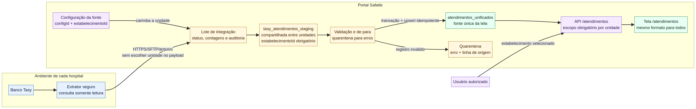

# Arquitetura recomendada para Atendimentos Tasy multiestabelecimento

**Data da análise:** 21 de setembro de 2026  
**Escopo:** reutilizar a tela `/atendimentos` para novos estabelecimentos que usam Tasy, mantendo isolamento rigoroso por unidade e sem depender, neste momento, da VPN site-to-site.

## Recomendação executiva

A melhor solução é usar **uma única tabela de staging Tasy para todos os estabelecimentos**, seguida por uma promoção controlada para a tabela já existente `atendimentos_unificados`, que deve continuar sendo a única fonte da tela.

> **O estabelecimento não precisa vir no resultado da consulta Tasy.** Ele deve ser atribuído pelo Portal Safatle a partir da configuração da integração (`configId → estabelecimentoId`) antes de qualquer linha entrar no staging.

Não recomendo criar uma tabela de staging por cliente, nem usar gatilho de banco para copiar automaticamente staging para a tabela principal. O fluxo deve ser executado por um serviço de sincronização explícito, com lote, validação, transação, auditoria, idempotência e quarentena de erros.



## Resposta direta às três dúvidas

| Dúvida | Decisão recomendada |
|---|---|
| Usar staging dentro do banco do Portal? | **Sim.** O staging separa a extração externa da tabela usada pela tela e impede carga parcial ou inválida em produção. |
| O staging deve disparar automaticamente para a principal? | **Sim, mas por um serviço de promoção, não por trigger.** O serviço valida o lote completo e só então promove os dados em transação. |
| Usar uma única staging Tasy para todos os clientes? | **Sim.** Use `tasy_atendimentos_staging`, sempre com `estabelecimentoId`, `configId` e `batchId` obrigatórios. |
| Como definir o estabelecimento se o Tasy não envia esse campo? | A credencial ou configuração da integração identifica a unidade. O servidor carimba `estabelecimentoId`; a linha recebida não escolhe nem altera essa unidade. |
| Como manter a mesma tela? | A tela continua lendo `atendimentos_unificados`. Cada origem é normalizada para o mesmo contrato de campos. |

## Estado atual confirmado no projeto

A aplicação já possui a maior parte do desenho necessário. A rota `/atendimentos` lê `atendimentos_unificados`, e essa tabela já contém `estabelecimentoId`, `origemSistema` e os campos específicos do Tasy. Portanto, **não é necessário criar uma segunda tela**.

Entretanto, o modelo histórico de staging ainda está separado por cliente. A auditoria encontrou `Tasy_maternidadeela_atendimentos_stagion`, com **4.135 registros**, e `TASY_hemolabor_atendimentos_stagion`, com **250.885 registros**. Os números de atendimento não colidem entre essas duas unidades hoje, mas isso não deve ser tratado como garantia futura.

A tabela `atendimentos_unificados` atualmente contém **667 registros do EasyVision no Instituto do Rim**. Não há dados Tasy promovidos nela neste momento. Também foi confirmado que a chave única atual é apenas `(origemSistema, origemId)`, sem `estabelecimentoId`.

| Ponto atual | Avaliação |
|---|---|
| Tabela final unificada já existe | **Adequado** e deve ser preservado |
| `estabelecimentoId` existe na tabela final | **Adequado**, desde que passe a ser obrigatório em todas as consultas |
| Staging Tasy separado por cliente | **Deve ser substituído** por staging compartilhado |
| Chave única `(origemSistema, origemId)` | **Insuficiente** para Tasy multiestabelecimento |
| `/atendimentos` usa consulta sem paginação | **Risco de desempenho** para volumes como 250 mil registros |
| `estabelecimentoId` é opcional em procedures da tela | **Deve ser obrigatório** antes do novo cliente |
| Notificações de atendimento | Os **894 registros atuais** estão sem estabelecimento e o lookup usa apenas número do atendimento; precisa ser isolado por unidade |

## Modelo de dados proposto

### 1. Configuração da fonte

Cada integração deve possuir um registro único em `query_configuracoes` ou em uma configuração equivalente.

| Campo | Função |
|---|---|
| `id` (`configId`) | Identifica tecnicamente a fonte |
| `estabelecimentoId` | Unidade proprietária de todos os dados extraídos por essa configuração |
| `sistema` | `tasy` |
| `tipoDados` | `atendimentos` |
| `ativo` | Habilita ou bloqueia a sincronização |
| `frequencia` | Define a agenda operacional |
| credencial/segredo | Referência segura; nunca exposta na tela nem gravada em logs |

A regra de segurança deve ser:

```text
configId autenticado → estabelecimentoId conhecido pelo servidor
linha Tasy → nunca pode informar ou substituir estabelecimentoId
```

Se o hospital usar um agente local que envia os dados por HTTPS, cada estabelecimento deve possuir uma credencial própria vinculada a um único `configId`. Se for importação manual de arquivo, o usuário escolhe a unidade antes do upload e o servidor valida que ele possui acesso a ela.

### 2. Lote de integração

Recomendo criar uma tabela `integracao_lotes` para controlar cada execução.

| Campo principal | Finalidade |
|---|---|
| `id` | Identificador interno do lote |
| `configId` e `estabelecimentoId` | Escopo imutável da execução |
| `origemSistema` e `tipoDados` | `tasy` e `atendimentos` |
| `status` | `recebido`, `validando`, `promovido`, `parcial`, `rejeitado` ou `falhou` |
| contagens | Recebidos, válidos, rejeitados, inseridos, atualizados e inativados |
| `iniciadoEm` e `finalizadoEm` | Monitoramento operacional |
| `erroResumo` | Diagnóstico sem dados sensíveis |

### 3. Staging compartilhado

A nova `tasy_atendimentos_staging` deve conter todos os clientes, mas nenhuma consulta pode ignorar `estabelecimentoId`.

```sql
CREATE TABLE tasy_atendimentos_staging (
  id BIGINT PRIMARY KEY AUTO_INCREMENT,
  batchId BIGINT NOT NULL,
  configId INT NOT NULL,
  estabelecimentoId INT NOT NULL,
  origemId VARCHAR(255) NOT NULL,
  origemAtualizadaEm DATETIME NULL,
  hashConteudo CHAR(64) NOT NULL,
  dadosBrutos JSON NOT NULL,
  statusValidacao VARCHAR(30) NOT NULL,
  erroValidacao TEXT NULL,
  criadoEm DATETIME NOT NULL,
  UNIQUE KEY uq_tasy_stage_lote_origem (batchId, origemId),
  INDEX idx_tasy_stage_estab_status (estabelecimentoId, statusValidacao)
);
```

O `dadosBrutos` preserva o registro original para auditoria. Campos muito usados na validação podem ser materializados em colunas tipadas, mas a linha sempre continua ligada ao lote, à configuração e à unidade.

### 4. Tabela final

`atendimentos_unificados` continua sendo a fonte da tela. A chave idempotente deve mudar para:

```text
(estabelecimentoId, origemSistema, origemId)
```

Isso evita que um atendimento `12345` do Hospital A atualize ou bloqueie o atendimento `12345` do Hospital B. O upsert deve ocorrer somente após validação e dentro de transação; um conflito nessa chave atualiza o registro da mesma unidade, nunca o de outra. O MySQL documenta que `ON DUPLICATE KEY UPDATE` reage a uma chave `UNIQUE`, por isso a composição correta do índice é parte da segurança do fluxo.[1]

Também recomendo adicionar `configId`, `ultimoBatchId`, `ultimaVezNaFonte`, `ativoNaFonte` e `hashConteudo` à tabela final. Assim, um atendimento que deixa de aparecer no snapshot do Tasy pode ser inativado somente depois de um lote completo e aprovado, sem apagar histórico.

## De-para para a tela atual

| Tasy/staging | `atendimentos_unificados` | Campo da tela |
|---|---|---|
| `numeroAtendimento` | `numero_atendimento` | Atendimento |
| `convenio` / `dsPlano` | `convenio` / `dsPlano` | Convênio e plano |
| `paciente` | `paciente` | Paciente |
| `dataAdmissao` | `data_entrada` | Entrada |
| `dataAlta` | `data_saida` | Alta |
| `tipoAtendimento` | `tipo_atendimento` e `descricao_atendimento` | Tipo |
| `servico` / `codServico` | `codigo_servico` / `codServico` | Serviço |
| `procedimentoPrincipal` | `codigo_procedimento` | Procedimento |
| `centroCusto` | `centroCusto` | Centro de custo |
| `etapaConta`, `setorEtapa`, `dtEtapa` | campos equivalentes | Etapa atual |
| `protTasy`, `nomeProtocolo`, `protConv` | campos equivalentes | Protocolo |
| `medicoResp`, `crm` | campos equivalentes | Médico |
| `valorConta` | `valorConta` | Valor |
| configuração da integração | `estabelecimentoId` | Escopo invisível e obrigatório |
| constante do normalizador | `origemSistema = 'tasy'` | Origem |

## Fluxo operacional recomendado

1. O extrator consulta o Tasy com usuário somente leitura e envia um lote identificado pelo `configId`.
2. O Portal resolve o `estabelecimentoId` pela configuração autenticada e grava o lote e o staging. A unidade não é aceita do payload.
3. O validador confere campos obrigatórios, datas, valores, duplicidade interna e o de-para. Linhas inválidas ficam em quarentena; não entram na tela.
4. Se o lote atingir os critérios de qualidade, o promotor inicia uma transação, faz o upsert por `(estabelecimentoId, origemSistema, origemId)`, marca ausentes como inativos quando a extração for snapshot completo e confirma o lote. `COMMIT` torna o conjunto permanente e `ROLLBACK` cancela tudo em caso de falha.[2]
5. A tela `/atendimentos` consulta somente `atendimentos_unificados`, exigindo `estabelecimentoId` autorizado, com paginação no servidor.
6. O painel do integrador exibe última execução, duração, totais, rejeições e erro operacional por estabelecimento.

## Correções obrigatórias antes do piloto

### Isolamento de leitura

Os inputs `estabelecimentoId` de `atendimentos.listar`, `listarPaginado` e procedimentos relacionados devem deixar de ser opcionais. Todas as consultas, inclusive histórico e notificações, devem exigir unidade positiva e autorização do usuário.

### Notificações

Hoje as notificações são localizadas apenas por `numatend`, e os 894 registros existentes não possuem unidade. Antes de ativar outro Tasy, a chave funcional deve ser pelo menos `(estabelecimentoId, origemSistema, numeroAtendimento)`. Os registros antigos precisam ser migrados somente quando a unidade puder ser comprovada; os ambíguos devem permanecer identificados como legado, sem associação inventada.

### Idempotência

O índice único atual de `atendimentos_unificados` não contém a unidade. Ele deve ser substituído por um índice composto que inclua `estabelecimentoId`. A promoção não deve usar “apagar tudo e inserir de novo”, porque uma falha intermediária pode deixar a tela vazia.

### Desempenho

A rota atual `/atendimentos` carrega toda a lista com `atendimentos.listar`. Para Tasy, isso não é adequado: uma das stagings existentes já possui mais de 250 mil linhas. O mesmo layout pode ser mantido, mas os filtros, ordenação, agregações e páginas devem usar `listarPaginado` no servidor.

### Ausência de trigger

Não recomendo trigger do staging para a tabela final. Trigger esconde a regra de negócio, dificulta reprocessamento, observabilidade e quarentena e promove linhas individualmente antes de validar o lote. A promoção deve ser uma função de serviço com transação explícita e execução idempotente.

## Estratégia sem VPN

Como a VPN foi adiada, o desenho pode operar por **saída HTTPS do hospital para o Portal**, sem abrir acesso de entrada no firewall. Um pequeno agente dentro da rede executa a consulta somente leitura, gera o lote e envia ao endpoint autenticado da unidade. Como alternativa inicial, o mesmo contrato pode receber arquivo CSV/JSON exportado e validado manualmente.

O transporte é intercambiável: quando IPsec ou OpenVPN estiver disponível, o extrator pode passar a consultar pela conexão privada sem mudar staging, normalização, tabela final ou tela.

## Plano de implantação

| Fase | Entrega | Critério de aceite |
|---|---|---|
| 1. Fundação | Staging única, lote, chave composta e guardas por unidade | Nenhuma consulta ou upsert funciona sem unidade autorizada |
| 2. Normalizador | De-para Tasy, validação e quarentena | Amostra do novo estabelecimento fecha quantidade e campos com a origem |
| 3. Piloto manual | Carga de arquivo do novo Tasy | Reprocessar o mesmo lote não duplica nem altera outra unidade |
| 4. Tela | `/atendimentos` com paginação e mesmo layout | Filtros e totais fecham com o staging promovido |
| 5. Automação | Agente HTTPS e agenda monitorada | Falhas geram auditoria; o último lote válido continua visível |
| 6. Expansão | Ativar demais estabelecimentos Tasy por `configId` | Nova unidade exige configuração, não nova tabela ou novo código |

## Decisão final

**Sim: uma staging Tasy compartilhada é a arquitetura correta.** O isolamento vem de `configId` e `estabelecimentoId` atribuídos pelo servidor, não de uma coluna fornecida pelo Tasy. A staging nunca deve alimentar a tabela principal por trigger; um promotor transacional, idempotente e auditável deve publicar o lote validado em `atendimentos_unificados`. Com isso, a mesma tela atende qualquer estabelecimento e o cadastro de uma nova unidade passa a ser configuração e de-para, não desenvolvimento de uma tabela exclusiva.

## Referências

[1]: https://dev.mysql.com/doc/refman/8.4/en/insert-on-duplicate.html "MySQL 8.4 — INSERT ... ON DUPLICATE KEY UPDATE"
[2]: https://dev.mysql.com/doc/refman/8.4/en/commit.html "MySQL 8.4 — START TRANSACTION, COMMIT e ROLLBACK"
