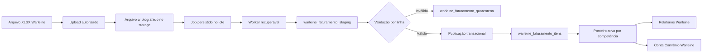

# Arquitetura implantada para faturamento Warleine

**Autor:** Manus AI  
**Data:** 21 de setembro de 2026

O mapeamento semântico detalhado dos campos está no documento [`dicionario-dados-warleine.md`](./dicionario-dados-warleine.md).

## Conclusão

A implantação mantém **uma única staging compartilhada para o Warleine**, sempre recortada por estabelecimento e por lote: `warleine_faturamento_staging`. Ela foi ampliada com `loteId`, número da linha, status, aviso e índices. Os campos canônicos tipados são publicados em `warleine_faturamento_itens`; a staging nunca alimenta relatórios diretamente.

A tabela `staging_faturamento_warleine` está vazia, não possui consumo ativo no código e não tem índices ou controle de lote suficientes. Ela pode ser removida **somente depois** da criação da nova estrutura, da migração validada e da autorização explícita para o `DROP TABLE`.

O arquivo recebido é um **XLSX de 60 MB**, embora tenha sido chamado de CSV. Ele contém **319.825 linhas**, das quais **319.784 foram validadas e publicadas** e 41 foram preservadas em quarentena. A publicação formou **26.877 contas** em seis competências, de `2026/01` a `2026/06`. Não contém somente contas sem recebimento: há valores pagos, valores em aberto, glosas e recursos no mesmo arquivo.

## Estado implantado

| Componente | Estado |
|---|---|
| Lotes | `warleine_faturamento_lotes`, com hash por estabelecimento, totais, status e competências |
| Staging única | `warleine_faturamento_staging`, compartilhada e isolada por `estabelecimentoId` e `loteId` |
| Quarentena | `warleine_faturamento_quarentena`, com 41 linhas não publicadas neste lote |
| Publicação | `warleine_faturamento_itens`, com snapshot ativo por estabelecimento e competência |
| Conta Convênio | `/conta-convenio-warleine`, usando somente a publicação Warleine |
| Faturado x Recebido | `/faturado-recebido-warleine`, mesma interface do oficial e fonte isolada |
| BI de Glosas | `/relatorios-glosas-warleine`, mesma interface do oficial e fonte isolada |
| Fonte oficial existente | Mantida sem alterações e sem soma automática com Warleine |

O lote piloto do Instituto do Rim foi publicado com **R$ 25.511.790,73 faturados**, **R$ 21.863.777,63 recebidos**, **R$ 2.770.054,93 em aberto** e **R$ 994.221,78 glosados**. A diferença de R$ 40,00 no faturado e de R$ 2.816,31 no aberto em relação ao total bruto está integralmente nas 41 linhas rejeitadas; nenhum valor foi estimado ou fabricado.

## Auditoria do arquivo recebido

| Indicador | Resultado |
|---|---:|
| Linhas de itens | 319.825 |
| Colunas úteis | 48 |
| Contas distintas | 26.878 |
| Guias de cobrança distintas | 26.752 |
| Guias da operadora distintas | 26.424 |
| Convênios | 10 |
| Valor faturado | R$ 25.511.830,73 |
| Valor recebido | R$ 21.750.361,37 |
| Valor total recebido informado | R$ 21.863.777,63 |
| Valor em aberto | R$ 2.772.871,24 |
| Valor glosado | R$ 994.221,78 |
| Valor em recurso | R$ 621.407,70 |
| Glosa aceita | R$ 262.713,72 |
| Glosa em análise | R$ 31,04 |
| Glosa recuperada | R$ 110.131,40 |
| Linhas com glosa | 30.752 |
| Linhas com glosa sem motivo | 6 |
| Linhas com valor recebido | 284.521 |
| Linhas com valor em aberto | 10.608 |
| Duplicatas exatas | 0 |

Os dados permitem produzir, sem estimativa, indicadores por competência, convênio, conta, guia, item, grupo financeiro, setor, tipo de atendimento, prestador, motivo de glosa e estágio do recurso.

## Problemas de qualidade encontrados

O arquivo possui dois cabeçalhos chamados `descricao`. Pela posição no layout, o primeiro representa a descrição do item e o segundo está associado ao grupo financeiro identificado por `codgrufi`. Existem também dois cabeçalhos `codrecur`. Eles coincidem em 319.822 linhas, mas divergem em três linhas. O importador não pode transformar a planilha em objeto apenas pelo nome dos cabeçalhos, pois isso sobrescreveria uma coluna pela outra.

Também foram identificadas **41 linhas com deslocamento estrutural de campos**. Nessas linhas, códigos, datas ou descrições aparecem em colunas que deveriam conter valores controlados. Em 25 delas, existe ainda conteúdo inesperado na 49ª coluna, cujo cabeçalho está vazio. Essas linhas devem ir para quarentena e nunca ser publicadas silenciosamente.

A chave operacional formada por conta, item, data, quantidade, valor, indicação de recebimento e setor aparece repetida em 277 grupos, totalizando 287 ocorrências adicionais. Como não existem duplicatas exatas, essas repetições podem representar desdobramentos legítimos. Elas não devem ser eliminadas sem uma regra de consolidação comprovada.

## Situação das tabelas atuais

| Tabela | Estado no banco | Uso atual | Avaliação |
|---|---:|---|---|
| `warleine_faturamento_staging` | Staging canônica versionada por lote | Importação XLSX e futuro adaptador do banco | Deve permanecer |
| `staging_faturamento_warleine` | 0 linhas | Nenhuma referência ativa | Candidata à remoção após migração e autorização |
| `faturamento_geral` | 0 linhas | Destino de uma transformação antiga | Não deve ser a nova fonte principal |
| `integ_faturado` | 0 linhas | Consumida por Conta Convênio e relatórios legados | Compatibilidade temporária; exige correção de chave e escopo |
| `faturamento_unificado` | Fonte oficial com XML TISS do Instituto do Rim | BI e conciliação existentes | Permanece isolada; não recebe este piloto Warleine |

A sincronização antiga de `integ_faturado` agrupa dados por conta e perde o detalhamento de item. Além disso, gera `_id` começando em 1 a cada estabelecimento, embora `_id` seja chave primária global. Esse desenho não é seguro para múltiplos estabelecimentos e não deve ser usado para a nova carga sem correção.

## Duas opções viáveis

| Abordagem | Como funciona | Trade-offs | Custo | Complexidade de implantação |
|---|---|---|---|---|
| Consolidação mínima | Mantém `warleine_faturamento_staging` com JSON e adapta o fluxo atual para preencher `integ_faturado` | Mais rápida, mas preserva perda de campos, dificulta auditoria e mantém risco de duplicidade e chave global | Baixo, sem nova infraestrutura | Baixa |
| Pipeline auditável por lote | Amplia `warleine_faturamento_staging`, cria lote e quarentena e publica em `warleine_faturamento_itens` | Preserva todos os valores válidos, permite reprocessamento idempotente e mantém a fonte oficial sem duplicidade | Médio de desenvolvimento, sem nova infraestrutura recorrente | Média |

A segunda abordagem foi escolhida e implantada com relatórios separados durante o piloto.

## Modelo recomendado

## Como impedir duplicidade entre Warleine e XML

O banco deve preservar a origem de cada registro, mas as telas não devem somar todas as origens. O mesmo item pode existir no XML enviado ao convênio e no faturamento extraído do Warleine. A deduplicação precisa ocorrer por uma **chave de negócio do item**, nunca apenas por competência ou por número da conta.

A chave recomendada combina `estabelecimentoId`, conta, guia, código do item, data de execução, quantidade, valor faturado e indicação `receber`. A descrição pode ajudar na conferência, mas não deve ser a única chave porque pode variar entre fontes. Quando o código da guia muda entre prestador e operadora, as duas variantes devem ser consideradas pela conciliação.

Cada registro publicado mantém `loteId`, `chaveNegocioHash`, `linhaHash` e `ativoParaRelatorio`. Durante o piloto, nenhuma origem é desativada na base oficial: as rotas Warleine consultam exclusivamente `warleine_faturamento_itens`, enquanto as rotas oficiais continuam consultando XML e demonstrativos. Assim, não há soma entre fontes nem alteração silenciosa dos relatórios existentes.

A regra atual de `popularFaturamentoUnificado` não é suficiente. Ela deixa de importar XML quando encontra Warleine, mas não desativa XMLs que já estavam publicados. Portanto, uma carga histórica posterior do Warleine ainda poderia coexistir com XML antigo e duplicar os totais.

No estado atual do Instituto do Rim, o arquivo recebido contém competências de `2026/01` a `2026/06`, enquanto os XMLs existentes em `faturamento_unificado` estão em `2026/07`, `2026/08` e `2026/09`. Portanto, **este arquivo específico não se sobrepõe aos XMLs atuais por competência**. A proteção continua necessária para futuras extrações do banco Warleine que incluam julho em diante.

## Como impedir duplicidade no Faturado x Recebido

O BI atual inicia o recebido e a glosa com os valores de `faturamento_unificado` e depois soma novamente `recebimentos_excel`. Se os valores do arquivo Warleine forem publicados diretamente em `valorPago` e `valorGlosa`, os mesmos pagamentos poderão ser contados duas vezes quando também existirem nos demonstrativos.

A regra recomendada separa a fonte autoritativa de cada métrica:

| Métrica | Fonte principal | Fallback | Regra |
|---|---|---|---|
| Faturado | Warleine | XML enviado | XML só entra quando não existir item Warleine equivalente |
| Recebido | Demonstrativo conciliado | Warleine | Nunca somar as duas fontes para o mesmo item |
| Glosado | Demonstrativo conciliado | Warleine | Nunca somar as duas fontes para o mesmo item |
| Em aberto | Saldo calculado do item canônico | Valor em aberto do Warleine | Não somar saldo do Warleine ao saldo calculado |
| Recurso e recuperação | Warleine/recurso vinculado | Demonstrativo quando aplicável | Manter origem e estado, sem somar eventos repetidos |

O BI deve consultar uma visão canônica que produza **uma linha financeira por item**. Para cada item, a visão seleciona o faturado da fonte prioritária e usa o demonstrativo conciliado como pagamento/glosa. Os valores de pagamento do Warleine continuam armazenados para auditoria e comparação, mas só entram como fallback quando não houver demonstrativo vinculado.

Essa mudança também corrige a diferença de escopo entre `recebimentos_excel` e `demonstrativo`. O primeiro já é a projeção consumida pelo BI; o segundo guarda o demonstrativo operacional. Eles não devem ser somados entre si.

## Como funcionará quando a fonte mudar de arquivo para banco

O arquivo e a conexão direta devem usar o mesmo pipeline. Apenas o adaptador de entrada muda:

- no arquivo, o lote registra hash, nome, tamanho e linha do XLSX/CSV;
- na conexão, o lote registra `configId`, intervalo consultado e identificador da execução;
- ambos gravam na mesma `warleine_faturamento_staging` com o mesmo modelo tipado;
- ambos passam pelas mesmas regras de validação, quarentena, idempotência e publicação;
- o `estabelecimentoId` vem sempre da unidade autorizada no portal ou da configuração do conector, nunca de uma coluna do arquivo ou de um valor inferido.

Uma carga do banco pode ser incremental por data de atualização, mas deve fechar um lote antes de publicar. Se uma sincronização falhar no meio, o lote continua recuperável e nenhum snapshot parcial deve substituir o conjunto ativo.

## Relatório separado para os dados do sistema

Para a entrada de julho em diante, a opção mais segura é criar inicialmente um relatório **Faturado x Recebido — Sistema Warleine**. Ele deve reutilizar exatamente o mesmo componente visual do relatório atual, alterando apenas a consulta de dados. Isso evita manter duas interfaces diferentes e, ao mesmo tempo, impede que XML, demonstrativo e Warleine sejam somados sem uma conciliação comprovada.

| Opção | Funcionamento | Vantagem | Limitação |
|---|---|---|---|
| Novo relatório com a mesma interface | O relatório atual permanece inalterado e uma nova rota consulta apenas a base Warleine | Isolamento total, validação simples e nenhum risco de duplicar o relatório atual | O usuário alterna entre duas páginas durante o piloto |
| Uma página com seletor de base | A tela atual recebe as opções `Oficial`, `Sistema Warleine` e `Comparativo` | Experiência centralizada e mesma URL | Exige mais cuidado visual para o usuário não confundir as bases |

Durante o piloto, recomenda-se o **novo relatório com a mesma interface**. Depois que julho em diante for confrontado e aprovado, as duas visões podem ser reunidas em uma única página sem alterar as regras de cálculo.

O relatório atual continuará mostrando a visão oficial baseada no XML enviado e nos demonstrativos recebidos. O novo relatório usará somente o snapshot publicado do Warleine e poderá mostrar faturado, recebido, em aberto, glosado, em recurso, aceito, em análise e recuperado.

Os relatórios não devem consultar a staging diretamente. A staging é temporária e pode conter linhas inválidas ou um lote incompleto. Após a validação, os dados devem ser publicados em uma tabela final tipada, por exemplo `warleine_faturamento_itens`, com versão ativa por estabelecimento e competência. Essa tabela alimentará exclusivamente o relatório do sistema durante o piloto.

Uma terceira visão, **Comparativo**, pode relacionar as fontes sem somá-las. Ela mostrará, para a mesma conta ou item, o valor do Warleine ao lado do valor do XML ou demonstrativo e classificará o resultado como coincidente, ausente em uma fonte ou divergente. Dessa forma, o relatório ajuda a escolher a fonte definitiva sem fabricar um total híbrido.

Quando o Warleine for aprovado como fonte oficial, a regra poderá ser alterada por estabelecimento e competência: faturado do Warleine; recebido e glosa do demonstrativo conciliado; fallback do próprio Warleine apenas quando não houver demonstrativo. Os XMLs continuarão armazenados para auditoria, mas deixarão de participar dos somatórios daquela competência.

### `warleine_faturamento_lotes`

Esta tabela registra o arquivo ou a sincronização que originou os dados. Deve conter `estabelecimentoId`, tipo da fonte (`xlsx`, `csv` ou banco), `configId`, nome e hash do arquivo, tamanho, status, totais de linhas, contas, valores, avisos, rejeições, usuário e datas de processamento. A unicidade deve ser `(estabelecimentoId, arquivoHash)` para garantir idempotência sem misturar unidades.

### `warleine_faturamento_staging`

Esta é a única staging Warleine **operacional**. Cada linha tem `loteId`, `estabelecimentoId`, número da linha, hash da linha, campos normalizados e tipados, dados brutos preservados e status de validação. Valores financeiros usam `DECIMAL`; datas são civis; identificadores permanecem como texto para não perder zeros à esquerda. A tabela legada vazia permanece apenas até autorização explícita de exclusão e não participa do fluxo.

O mapeamento precisa ser posicional para os cabeçalhos duplicados. A primeira `descricao` deve receber um nome semântico diferente da descrição do item. Os dois `codrecur` devem ser preservados separadamente durante a validação; só depois podem ser consolidados quando forem iguais.

### `warleine_faturamento_quarentena`

Linhas deslocadas, inválidas ou sem conta devem ser registradas por lote e estabelecimento, com motivo objetivo. Os registros não podem chegar a Conta Convênio ou BI até correção e republicação.

### Publicação

A publicação é transacional e idempotente em `warleine_faturamento_itens`, com ativação somente depois da validação. Cada ocorrência física recebe a identidade canônica `hash do arquivo:número da linha`; assim, a reexecução do mesmo lote é idempotente, mas duas cobranças idênticas em linhas diferentes não são descartadas. Conteúdos idênticos repetidos são preservados e recebem o aviso `CONTEUDO_REPETIDO_NO_ARQUIVO` para auditoria.

A versão ativa é selecionada por `warleine_faturamento_snapshots_ativos`, uma tabela pequena com uma linha por estabelecimento e competência. Depois de materializar e validar todos os itens, o publicador troca esses ponteiros na transação final. As três telas consultam a view `warleine_faturamento_itens_ativos`; portanto, nunca observam lote incompleto e a troca não depende de atualizar centenas de milhares de linhas antigas.

Toda competência é comparada com o snapshot ativo por quantidade e pelos totais de faturado, recebido, aberto e glosa. Uma queda superior a **0,5%** em qualquer dimensão bloqueia a publicação. A exceção exige administrador, justificativa mínima, data e usuário persistidos no lote antes de um novo processamento integral. Os cálculos financeiros usam `Decimal` no parser, nas comparações de cobertura e nos agregados de relatórios; a conversão para `number` acontece apenas na borda da API, depois de validar a faixa segura.

O worker reclama cada job em transação, grava `claimToken`, proprietário e lease renovável, e condiciona limpeza, batches de staging, progresso, validação, materialização, falha e publicação final ao mesmo token e a um lease ainda vigente. Isso impede dois processos simultâneos para o mesmo lote e permite recuperação segura após reinício. O arquivo durável usa envelope criptográfico versionado; uma chave dedicada pode ser configurada em `WARLEINE_FILE_ENCRYPTION_KEY`, com compatibilidade controlada para arquivos anteriores.

A tela Conta Convênio pode receber uma projeção controlada desses itens em `contas_convenio_itens` e seus cabeçalhos em `contas_convenio_resumo`. Para impedir divergência, a projeção deve guardar referência ao item canônico e ser atualizada somente pelo publicador do lote.

## Resultados que o arquivo permite entregar

Na tela **Conta Convênio**, o sistema poderá listar todas as contas do lote, abrir os itens, mostrar valor faturado, recebido, em aberto e glosado, além do motivo de glosa, recurso e recuperação. A busca poderá usar conta, guia, paciente, convênio, competência, setor, item e prestador.

Nos **Relatórios BI**, será possível apresentar faturado, recebido, aberto e glosado por competência, convênio, item, grupo financeiro, setor e tipo de atendimento. Também será possível medir taxa de glosa, taxa de recuperação, principais motivos, valores aceitos, valores em análise e recursos ainda sem recuperação.

## Decisões e pendência operacional

1. O arquivo foi vinculado ao estabelecimento **Instituto do Rim** pela unidade autorizada do portal; o vínculo nunca é inferido da planilha.
2. As seis competências encontradas, de `2026/01` a `2026/06`, foram publicadas.
3. O pipeline auditável por lote foi implantado e os caminhos legados que poderiam duplicar, transformar ou limpar dados foram bloqueados.
4. O upload grava uma cópia criptografada no storage, reserva um job persistido e retorna sem depender da duração da requisição. O worker retoma jobs após reinício, limita tentativas e registra progresso e falhas no lote.
5. A tabela vazia `staging_faturamento_warleine` continua aguardando autorização destrutiva específica para o `DROP TABLE`. Nenhuma migração de exclusão está versionada; `warleine_faturamento_staging` é a única staging operacional.
6. A prova final do worker reprocessou 319.825 linhas em 369 segundos, publicou 319.784 itens e preservou os seis ponteiros ativos durante todo o processamento. O validador confirmou 26.877 contas, 197 conteúdos repetidos preservados, 41 linhas em quarentena e isolamento aprovado.

## References

[1]: https://github.com/sergiohlsafatlejr-jpg/safatle-sistema "Repositório Safatle Sistema"
