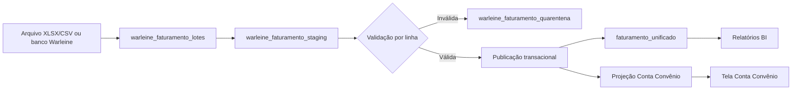

# Arquitetura proposta para faturamento Warleine

**Autor:** Manus AI  
**Data:** 21 de setembro de 2026

## Conclusão

A melhor organização é manter **uma única staging compartilhada para o Warleine**, sempre recortada por estabelecimento e por lote de importação. A tabela que deve permanecer é `warleine_faturamento_staging`, porque ela já é usada pelo integrador automático. Porém, seu modelo atual, com apenas `estabelecimentoId`, `configId` e `dadosBrutos`, precisa ser ampliado para receber campos tipados, rastreamento de lote, hash da linha e status de validação.

A tabela `staging_faturamento_warleine` está vazia, não possui consumo ativo no código e não tem índices ou controle de lote suficientes. Ela pode ser removida **somente depois** da criação da nova estrutura, da migração validada e da autorização explícita para o `DROP TABLE`.

O arquivo recebido é um **XLSX de 60 MB**, embora tenha sido chamado de CSV. Ele contém **319.825 itens**, distribuídos em **26.878 contas** e seis competências, de `2026/01` a `2026/06`. Não contém somente contas sem recebimento: há valores pagos, valores em aberto, glosas e recursos no mesmo arquivo.

## Auditoria do arquivo recebido

| Indicador | Resultado |
|---|---:|
| Linhas de itens | 319.825 |
| Colunas úteis | 48 |
| Contas distintas | 26.878 |
| Guias de cobrança distintas | 26.752 |
| Guias da operadora distintas | 26.424 |
| Convênios | 10 |
| Valor faturado | R$ 25.511.830,73 |
| Valor recebido | R$ 21.750.361,37 |
| Valor total recebido informado | R$ 21.863.777,63 |
| Valor em aberto | R$ 2.772.871,24 |
| Valor glosado | R$ 994.221,78 |
| Valor em recurso | R$ 621.407,70 |
| Glosa aceita | R$ 262.713,72 |
| Glosa em análise | R$ 31,04 |
| Glosa recuperada | R$ 110.131,40 |
| Linhas com glosa | 30.752 |
| Linhas com glosa sem motivo | 6 |
| Linhas com valor recebido | 284.521 |
| Linhas com valor em aberto | 10.608 |
| Duplicatas exatas | 0 |

Os dados permitem produzir, sem estimativa, indicadores por competência, convênio, conta, guia, item, grupo financeiro, setor, tipo de atendimento, prestador, motivo de glosa e estágio do recurso.

## Problemas de qualidade encontrados

O arquivo possui dois cabeçalhos chamados `descricao`. Pela posição no layout, o primeiro representa a descrição do item e o segundo está associado ao grupo financeiro identificado por `codgrufi`. Existem também dois cabeçalhos `codrecur`. Eles coincidem em 319.822 linhas, mas divergem em três linhas. O importador não pode transformar a planilha em objeto apenas pelo nome dos cabeçalhos, pois isso sobrescreveria uma coluna pela outra.

Também foram identificadas **41 linhas com deslocamento estrutural de campos**. Nessas linhas, códigos, datas ou descrições aparecem em colunas que deveriam conter valores controlados. Em 25 delas, existe ainda conteúdo inesperado na 49ª coluna, cujo cabeçalho está vazio. Essas linhas devem ir para quarentena e nunca ser publicadas silenciosamente.

A chave operacional formada por conta, item, data, quantidade, valor, indicação de recebimento e setor aparece repetida em 277 grupos, totalizando 287 ocorrências adicionais. Como não existem duplicatas exatas, essas repetições podem representar desdobramentos legítimos. Elas não devem ser eliminadas sem uma regra de consolidação comprovada.

## Situação das tabelas atuais

| Tabela | Estado no banco | Uso atual | Avaliação |
|---|---:|---|---|
| `warleine_faturamento_staging` | 0 linhas | Usada pelo integrador automático | Deve permanecer e ser ampliada |
| `staging_faturamento_warleine` | 0 linhas | Nenhuma referência ativa | Candidata à remoção após migração e autorização |
| `faturamento_geral` | 0 linhas | Destino de uma transformação antiga | Não deve ser a nova fonte principal |
| `integ_faturado` | 0 linhas | Consumida por Conta Convênio e relatórios legados | Compatibilidade temporária; exige correção de chave e escopo |
| `faturamento_unificado` | 36.448 linhas, somente XML TISS do Instituto do Rim | Fonte analítica já usada por BI e conciliação | Deve ser o destino canônico dos itens Warleine |

A sincronização antiga de `integ_faturado` agrupa dados por conta e perde o detalhamento de item. Além disso, gera `_id` começando em 1 a cada estabelecimento, embora `_id` seja chave primária global. Esse desenho não é seguro para múltiplos estabelecimentos e não deve ser usado para a nova carga sem correção.

## Duas opções viáveis

| Abordagem | Como funciona | Trade-offs | Custo | Complexidade de implantação |
|---|---|---|---|---|
| Consolidação mínima | Mantém `warleine_faturamento_staging` com JSON e adapta o fluxo atual para preencher `integ_faturado` | Mais rápida, mas preserva perda de campos, dificulta auditoria e mantém risco de duplicidade e chave global | Baixo, sem nova infraestrutura | Baixa |
| Pipeline auditável por lote | Amplia `warleine_faturamento_staging`, cria lote e quarentena, valida os campos e publica em `faturamento_unificado` e na projeção de Conta Convênio | Exige mais desenvolvimento inicial, mas preserva todos os valores, permite reprocessamento idempotente e atende vários estabelecimentos com segurança | Médio de desenvolvimento, sem nova infraestrutura recorrente | Média |

A segunda abordagem é a mais adequada para Conta Convênio e BI, mas a escolha final deve ser confirmada antes da implementação.

## Modelo recomendado

## Como impedir duplicidade entre Warleine e XML

O banco deve preservar a origem de cada registro, mas as telas não devem somar todas as origens. O mesmo item pode existir no XML enviado ao convênio e no faturamento extraído do Warleine. A deduplicação precisa ocorrer por uma **chave de negócio do item**, nunca apenas por competência ou por número da conta.

A chave recomendada combina `estabelecimentoId`, conta, guia, código do item, data de execução, quantidade, valor faturado e indicação `receber`. A descrição pode ajudar na conferência, mas não deve ser a única chave porque pode variar entre fontes. Quando o código da guia muda entre prestador e operadora, as duas variantes devem ser consideradas pela conciliação.

Cada registro publicado deve manter `origemSistema`, `origemId`, `loteId`, `chaveNegocioHash` e `ativoParaRelatorio`. Quando houver o mesmo item nas duas fontes, o Warleine fica ativo para o **valor faturado** e o XML permanece armazenado, mas inativo para somatórios. Assim não se perde rastreabilidade nem se duplica o faturamento.

A regra atual de `popularFaturamentoUnificado` não é suficiente. Ela deixa de importar XML quando encontra Warleine, mas não desativa XMLs que já estavam publicados. Portanto, uma carga histórica posterior do Warleine ainda poderia coexistir com XML antigo e duplicar os totais.

No estado atual do Instituto do Rim, o arquivo recebido contém competências de `2026/01` a `2026/06`, enquanto os XMLs existentes em `faturamento_unificado` estão em `2026/07`, `2026/08` e `2026/09`. Portanto, **este arquivo específico não se sobrepõe aos XMLs atuais por competência**. A proteção continua necessária para futuras extrações do banco Warleine que incluam julho em diante.

## Como impedir duplicidade no Faturado x Recebido

O BI atual inicia o recebido e a glosa com os valores de `faturamento_unificado` e depois soma novamente `recebimentos_excel`. Se os valores do arquivo Warleine forem publicados diretamente em `valorPago` e `valorGlosa`, os mesmos pagamentos poderão ser contados duas vezes quando também existirem nos demonstrativos.

A regra recomendada separa a fonte autoritativa de cada métrica:

| Métrica | Fonte principal | Fallback | Regra |
|---|---|---|---|
| Faturado | Warleine | XML enviado | XML só entra quando não existir item Warleine equivalente |
| Recebido | Demonstrativo conciliado | Warleine | Nunca somar as duas fontes para o mesmo item |
| Glosado | Demonstrativo conciliado | Warleine | Nunca somar as duas fontes para o mesmo item |
| Em aberto | Saldo calculado do item canônico | Valor em aberto do Warleine | Não somar saldo do Warleine ao saldo calculado |
| Recurso e recuperação | Warleine/recurso vinculado | Demonstrativo quando aplicável | Manter origem e estado, sem somar eventos repetidos |

O BI deve consultar uma visão canônica que produza **uma linha financeira por item**. Para cada item, a visão seleciona o faturado da fonte prioritária e usa o demonstrativo conciliado como pagamento/glosa. Os valores de pagamento do Warleine continuam armazenados para auditoria e comparação, mas só entram como fallback quando não houver demonstrativo vinculado.

Essa mudança também corrige a diferença de escopo entre `recebimentos_excel` e `demonstrativo`. O primeiro já é a projeção consumida pelo BI; o segundo guarda o demonstrativo operacional. Eles não devem ser somados entre si.

## Como funcionará quando a fonte mudar de arquivo para banco

O arquivo e a conexão direta devem usar o mesmo pipeline. Apenas o adaptador de entrada muda:

- no arquivo, o lote registra hash, nome, tamanho e linha do XLSX/CSV;
- na conexão, o lote registra `configId`, intervalo consultado e identificador da execução;
- ambos gravam na mesma `warleine_faturamento_staging` com o mesmo modelo tipado;
- ambos passam pelas mesmas regras de validação, quarentena, idempotência e publicação;
- o `estabelecimentoId` vem sempre da unidade autorizada no portal ou da configuração do conector, nunca de uma coluna do arquivo ou de um valor inferido.

Uma carga do banco pode ser incremental por data de atualização, mas deve fechar um lote antes de publicar. Se uma sincronização falhar no meio, o lote continua recuperável e nenhum snapshot parcial deve substituir o conjunto ativo.

### `warleine_faturamento_lotes`

Esta tabela registra o arquivo ou a sincronização que originou os dados. Deve conter `estabelecimentoId`, tipo da fonte (`xlsx`, `csv` ou banco), `configId`, nome e hash do arquivo, tamanho, status, totais de linhas, contas, valores, avisos, rejeições, usuário e datas de processamento. A unicidade deve ser `(estabelecimentoId, arquivoHash)` para garantir idempotência sem misturar unidades.

### `warleine_faturamento_staging`

Esta será a única staging Warleine. Cada linha deve ter `loteId`, `estabelecimentoId`, número da linha, hash da linha, campos normalizados e tipados, dados brutos preservados e status de validação. Valores financeiros devem usar `DECIMAL`; datas devem ser datas civis; identificadores devem permanecer como texto para não perder zeros à esquerda.

O mapeamento precisa ser posicional para os cabeçalhos duplicados. A primeira `descricao` deve receber um nome semântico diferente da descrição do item. Os dois `codrecur` devem ser preservados separadamente durante a validação; só depois podem ser consolidados quando forem iguais.

### `warleine_faturamento_quarentena`

Linhas deslocadas, inválidas ou sem conta devem ser registradas por lote e estabelecimento, com motivo objetivo. Os registros não podem chegar a Conta Convênio ou BI até correção e republicação.

### Publicação

A publicação deve ser transacional e idempotente. `faturamento_unificado` deve ser a fonte canônica de itens para o BI. Ela precisa receber também os campos financeiros hoje ausentes: valor em aberto, recebido a maior, recurso, glosa aceita, glosa em análise e glosa recuperada.

A tela Conta Convênio pode receber uma projeção controlada desses itens em `contas_convenio_itens` e seus cabeçalhos em `contas_convenio_resumo`. Para impedir divergência, a projeção deve guardar referência ao item canônico e ser atualizada somente pelo publicador do lote.

## Resultados que o arquivo permite entregar

Na tela **Conta Convênio**, o sistema poderá listar todas as contas do lote, abrir os itens, mostrar valor faturado, recebido, em aberto e glosado, além do motivo de glosa, recurso e recuperação. A busca poderá usar conta, guia, paciente, convênio, competência, setor, item e prestador.

Nos **Relatórios BI**, será possível apresentar faturado, recebido, aberto e glosado por competência, convênio, item, grupo financeiro, setor e tipo de atendimento. Também será possível medir taxa de glosa, taxa de recuperação, principais motivos, valores aceitos, valores em análise e recursos ainda sem recuperação.

## Decisões necessárias antes da importação

1. Confirmar que o arquivo `IRG01-2026-06-2026.xlsx` pertence ao estabelecimento **Instituto do Rim**. O arquivo não contém `estabelecimentoId`; esse vínculo deve vir da unidade selecionada e autorizada no portal.
2. Confirmar se devem ser importadas todas as competências encontradas, de `2026/01` a `2026/06`, ou somente `2026/06`.
3. Escolher entre a consolidação mínima e o pipeline auditável por lote.
4. Autorizar separadamente a exclusão definitiva da tabela vazia `staging_faturamento_warleine` depois que a migração e os testes estiverem concluídos. Nenhuma tabela foi excluída nesta auditoria.

## References

[1]: https://github.com/sergiohlsafatlejr-jpg/safatle-sistema "Repositório Safatle Sistema"
