# Plano de automação do recurso de glosa

**Autor:** Manus AI  
**Data:** 16 de setembro de 2026

## Resumo executivo

O portal já possui grande parte da estrutura necessária: análise dos itens glosados, aceite ou recurso, geração de justificativas, criação de registros de recurso quando uma guia é concluída, agrupamento por convênio, criação de lotes, exportação, registro de envio, resposta, pagamento e histórico.[1] [2] [3]

O principal risco atual é automatizar decisões usando uma base histórica desequilibrada. O banco possui **40.040 itens pendentes**, somando **R$ 2.162.357,26**, mas as 4.618 decisões históricas registradas são exclusivamente de aceite. Não há decisões históricas de recurso nem resultados concluídos suficientes para sustentar uma decisão autônoma confiável. Portanto, a primeira automação deve preparar e priorizar o trabalho, mantendo a aprovação humana antes de aceitar glosas, formar lotes ou enviar arquivos.

## O que já funciona

| Etapa | Situação atual |
|---|---|
| Identificação da glosa | Os itens glosados chegam ao `demonstrativo` com estabelecimento, convênio, guia, procedimento, valor e motivo. |
| Decisão | O usuário pode aceitar ou recursar e o sistema registra a decisão. |
| Sugestão | Existe sugestão baseada no histórico, com confiança calculada. |
| Justificativa | É possível salvar, replicar e gerar justificativas assistidas para itens selecionados. |
| Finalização da guia | Quando todos os itens estão decididos, o sistema cria automaticamente os recursos dos itens recursados. |
| Lotes | Os recursos podem ser agrupados por convênio e data de pagamento e incluídos em lote. |
| Arquivos | O portal gera XML e possui exportações Excel e PDF conforme os fluxos existentes. |
| Acompanhamento | Há status de envio, análise, resposta, deferimento, indeferimento, pagamento e histórico. |

## Lacunas encontradas

O procedimento de classificação automática existe no backend, porém não é executado após a importação, não possui agendamento e não aparece como ação operacional na interface. A criação de lotes continua manual, o controle de prazos não possui execução periódica e o retorno do convênio ainda precisa ser registrado pelo usuário. Além disso, os estados estão distribuídos entre `demonstrativo`, `recursosGlosa`, `lotesRecurso` e tabelas de conciliação, o que exige uma camada única de orquestração para impedir transições inconsistentes.[1] [2]

> **Regra de segurança:** nenhuma classificação automática deve aceitar definitivamente uma glosa ou enviar um recurso enquanto a base histórica não contiver decisões recursadas e resultados reais suficientes por estabelecimento, convênio, código de glosa e procedimento.

## Opções de implantação

| Approach | Tradeoffs | Cost | Setup Complexity |
|---|---|---|---|
| **Automação assistida** | O sistema classifica como sugestão, prepara justificativas e organiza uma fila; o usuário aprova as decisões e o lote. É a opção de menor risco, mas mantém uma etapa humana. | Baixo; execução determinística no próprio portal e IA somente quando solicitada. | Baixa a média. |
| **Automação operacional com aprovação final** | Regras aprovadas classificam itens, geram justificativas e montam lotes em rascunho; o usuário revisa e confirma o envio. Reduz mais trabalho, mas exige cadastro e governança de regras. | Baixo a moderado, dependendo do volume de justificativas assistidas. | Média. |
| **Automação ponta a ponta por convênio** | Além das etapas anteriores, envia ao portal/API da operadora e captura protocolo e resposta. É o fluxo mais rápido, porém cada convênio exige integração própria, credenciais e tratamento de falhas. | Variável por integração e infraestrutura. | Alta. |

## Fluxo proposto

```mermaid
flowchart LR
  A[Demonstrativo importado] --> B[Triagem automática]
  B --> C{Regra segura?}
  C -->|Não| D[Fila para análise humana]
  C -->|Sim| E[Sugestão aceitar ou recursar]
  E --> F[Justificativa em rascunho]
  D --> G[Aprovação do usuário]
  F --> G
  G --> H[Recursos prontos]
  H --> I[Lote em rascunho por convênio e período]
  I --> J[Validação humana]
  J --> K[Geração XML, Excel ou PDF]
  K --> L[Envio e protocolo]
  L --> M[Acompanhamento de prazo]
  M --> N[Resposta e valor recuperado]
  N --> O[Aprendizado auditado]
```

## Regras da primeira versão

As regras devem ser configuráveis por **estabelecimento e convênio**. Uma correspondência somente pode ser automática quando código de glosa, procedimento, tipo do item, faixa de valor e documentação necessária estiverem definidos. Regras incompletas, itens sem código de glosa, valores elevados, divergências cadastrais ou casos sem histórico devem sempre seguir para revisão humana.

| Resultado da triagem | Ação automática permitida | Aprovação humana |
|---|---|---|
| Regra conhecida de aceite | Criar sugestão de aceite e registrar evidência | Obrigatória no piloto |
| Regra conhecida de recurso | Preencher valor e justificativa em rascunho | Obrigatória antes do lote |
| Caso sem regra ou baixa confiança | Priorizar na fila e mostrar documentos faltantes | Obrigatória |
| Guia completamente revisada | Criar recursos pendentes de envio | Já suportado; manter idempotente |
| Recursos aprovados do mesmo convênio e período | Criar lote em rascunho | Obrigatória antes de gerar/enviar |
| Prazo próximo | Criar alerta e notificação | Não necessária para o alerta |
| Resposta recebida | Atualizar resultado e taxa histórica | Confirmação quando o retorno não for estruturado |

## Execução e agendamento

A triagem deve ser disparada **por evento**, imediatamente após a sincronização do demonstrativo, porque depende de uma nova importação. O monitoramento de prazos pode rodar diariamente em um trabalho periódico do próprio portal. Não devem ser usados temporizadores internos do processo. O trabalho diário deve ser idempotente e criar apenas alertas que ainda não existem.

O projeto ainda não possui a infraestrutura de trabalhos periódicos instalada. Ela deverá ser adicionada somente na etapa de alertas, seguida de publicação antes da ativação do agendamento. A classificação e a criação de lote não precisam aguardar esse componente; podem começar como ações eventuais e manuais na interface.

## Controles obrigatórios

| Controle | Aplicação |
|---|---|
| Isolamento | Toda regra, consulta, sugestão, lote e alerta deve exigir `estabelecimentoId` e `convenioId`. |
| Idempotência | Cada ação deve possuir uma chave única por item, versão da regra e etapa para impedir duplicação. |
| Auditoria | Registrar regra utilizada, confiança, usuário aprovador, valores antes/depois e horário. |
| Segurança | O envio permanece bloqueado até aprovação explícita; credenciais de operadoras nunca ficam no navegador. |
| Explicabilidade | A tela deve mostrar por que o item foi sugerido para aceite ou recurso e quais precedentes foram considerados. |
| Reversão | Sugestões podem ser rejeitadas sem apagar o histórico; decisões confirmadas exigem evento de correção. |
| Qualidade | A automação não processa itens sem valor de glosa, guia, convênio ou vínculo inequívoco. |

## Implantação incremental

### Etapa 1 — Central de triagem assistida

Criar uma fila única de glosas novas, agrupada por estabelecimento, convênio, motivo e procedimento. A fila mostrará sugestão, confiança, impacto financeiro e motivo. O usuário aprovará em lote ou enviará casos excepcionais para análise individual.

### Etapa 2 — Justificativas e documentos

Gerar rascunhos a partir do dicionário, dos argumentos por convênio e do histórico de casos concluídos. O uso de modelo de linguagem deve ser explícito, limitado a rascunhos e acompanhado de revisão humana. Antes da implementação, deverá ser escolhido e comunicado o modelo utilizado e seu custo estimado.

### Etapa 3 — Lotes automáticos em rascunho

Após a aprovação, agrupar por estabelecimento, convênio, período de pagamento e protocolo recursado. Validar duplicidade, valor, guia, prazo e formato antes de gerar XML, Excel ou PDF. O envio continua manual.

### Etapa 4 — Prazos, protocolos e respostas

Executar verificação diária de lotes próximos do vencimento, sem protocolo ou sem resposta. Gerar alertas no portal e registrar tentativas. Quando houver arquivo estruturado de retorno, importar e vincular automaticamente; caso contrário, solicitar confirmação humana.

### Etapa 5 — Integração com operadoras

Somente depois de validar as etapas anteriores, integrar APIs, portais ou automações específicas das operadoras. Cada convênio deverá ter um adaptador isolado, controle de credenciais, retentativa e confirmação de protocolo.

## Critérios de sucesso do piloto

| Métrica | Meta inicial sugerida |
|---|---:|
| Itens novos triados automaticamente | 100% |
| Decisões aplicadas sem aprovação humana | 0% no piloto |
| Recursos duplicados | 0 |
| Mistura entre estabelecimentos ou convênios | 0 |
| Guias incompletas enviadas para lote | 0 |
| Tempo de preparação por guia | Redução mensurada antes/depois |
| Prazo vencido sem alerta | 0 |

## Decisões necessárias antes da implementação

O primeiro piloto precisa definir um estabelecimento e um convênio. Também é necessário escolher até onde a automação irá inicialmente: apenas triagem e justificativa; triagem, justificativa e lote em rascunho; ou integração completa com envio. A terceira opção não deve começar antes da validação das duas primeiras.

## Referências internas

[1]: ../server/routers.ts "Rotas de recursos, classificação e lotes"
[2]: ../server/faturamentoUnificadoService.ts "Fluxo de justificativas e finalização de guias"
[3]: ../drizzle/schema.ts "Tabelas de recursos, lotes, histórico e decisões"
